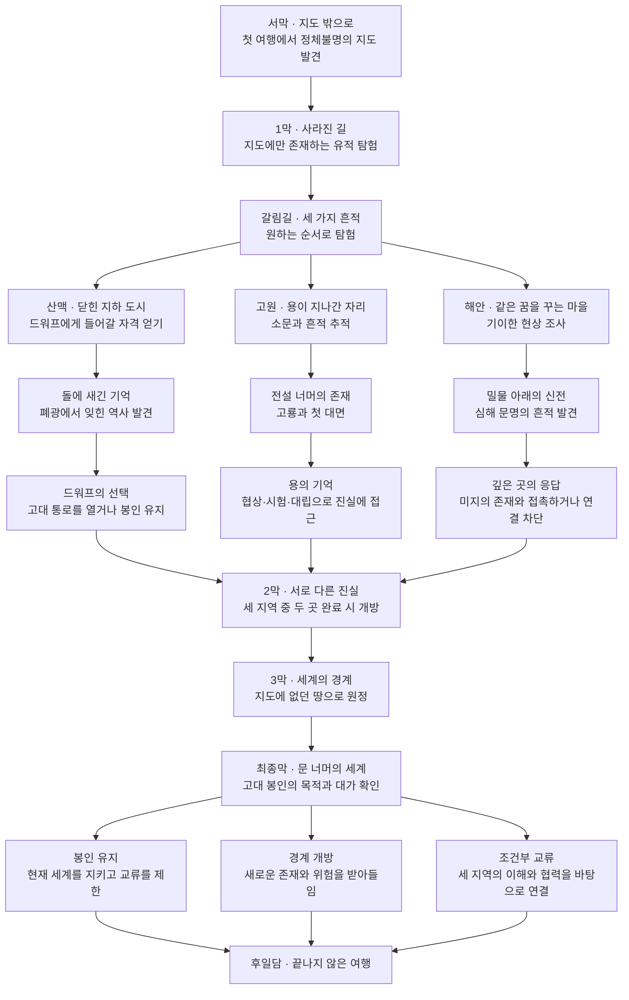

# 게임 개발 기준

기준일: 2026-10-27 (초반 이야기·지역 연결·후속 제작 계획 반영)

이 문서는 사용자와의 대화에서 정리한 프로젝트의 지속적인 개발 기준이다. 장르·표현·핵심 정서는 확정된 방향이며, 아래 세계관과 메인 퀘스트는 앞으로 유지하고 구체화할 기본 골격이다. 퀘스트 이름과 세부 사건은 작업용 초안이며 구현 완료를 의미하지 않는다.

## 1. 게임의 핵심 방향

**낯선 세계를 자유롭게 여행하며, 미지의 존재를 이해해 가는 실시간 렌더링 기반의 쿼터뷰 2.5D 싱글플레이 오픈 월드 RPG.**

| 항목 | 기준 |
|---|---|
| 장르 | 오픈 월드 RPG |
| 플레이 방식 | 싱글플레이 |
| 기술 기준 | C++ / OpenGL 유지 |
| 회복과 부활 | 각각 대가가 있음. 구체적인 형태와 수치는 미정 |
| 선택 이력 | 진행 중의 선택 이력을 이후 세계 상태에 반영 |
| 렌더링 | 실시간 렌더링 |
| 시점 | 쿼터뷰 |
| 표현 | 2.5D. 구체적인 2D·3D 요소 구성은 추후 결정 |
| 시간적 배경 | 검과 마법이 공존하는 중세 판타지 |
| 기본 분위기 | 자유로운 여행, 탐험의 설렘, 발견의 경이로움 |
| 스토리의 중심 | 드워프, 용, 크툴루 같은 미지의 존재와 종족을 알아가는 과정 |
| 플레이어의 기본 위치 | 방문할 장소와 관계를 맺을 대상을 선택하는 탐험가 |

## 2. 세계와 분위기

- 도시와 교역로 밖에는 지도에 기록되지 않은 땅이 많다.
- 마을에서는 따뜻함을, 유적에서는 신비함을, 세계 깊숙한 곳에서는 두려움을 느낀다.
- 공포는 특정 지역과 이야기에서 강해진다. 세계 전체의 기본 정서는 다음 장소에 대한 호기심과 모험의 즐거움으로 유지한다.
- 초·중반에는 세계 멸망 카운트다운으로 탐험을 재촉하지 않는다. 곁길 탐험과 일상적인 모험을 즐길 여유를 둔다.
- 종족과 존재는 각자의 생활, 역사, 목적을 가진다. 탐험을 통해 소문과 실제 모습의 차이를 알아간다.
- 모든 수수께끼를 설명하지 않는다. 결말 이후에도 만나지 못한 존재와 미지의 영역이 남는다.

## 3. 존재를 알아가는 방식

| 대상 | 만남과 이해의 방식 | 메인 스토리에서의 역할 |
|---|---|---|
| 드워프 | 지하 도시의 생활·기술·전통을 접하고 폐광과 기록을 탐험 | 세계를 연결하는 고대 통로의 건설자와 그 후손 |
| 용 | 흔적과 전설을 추적한 뒤 직접 대면. 협상·시험·대립을 통해 접근 | 봉인 이전의 세계를 기억하는 존재 |
| 크툴루 같은 심해의 미지 존재 | 꿈, 유적, 기이한 자연 현상을 통해 간접적으로 접촉 | 봉인 너머에서 접촉을 시도하며 이해의 한계를 드러내는 존재 |

크툴루 자체의 등장 여부, 고유 명칭과 정확한 정체는 미정이다. 현재는 이해하기 어려운 고대 존재의 방향을 나타내는 예시다.

## 4. 메인 스토리의 기본 골격

오래된 지도에만 남아 있던 장소들이 다시 발견되기 시작한다. 플레이어는 현실의 지형과 맞지 않는 지도를 얻고, 빈칸을 채우는 여정에서 드워프·용·심해의 존재가 서로 다른 방식으로 같은 비밀에 연결되어 있음을 알아간다.

각 지역은 독립적인 모험으로 시작하며, 후반에는 고대 통로와 세계의 경계, 봉인의 목적을 둘러싼 하나의 이야기로 이어진다.

### 초반 이야기: 돌아오는 길과 건너가는 길

프로토타입의 플레이어는 여행지의 길과 이야기를 기록하는 떠돌이 지도 기록자다. 혈통이나 세계를 구할 의무 때문에 출발하지 않는다. 갈대여울에서 잘못된 지도를 고쳐 달라는 부탁을 받고, 실제 지형과 기록의 차이에 호기심을 느껴 다음 장소로 향한다. 출신과 개인사의 전체 설정은 아직 정하지 않는다.

호숫가 표석의 문구는 **“건너온 이에게 길을, 돌아가는 이에게 표식을”**이다. 호수의 제단은 미지의 존재에게 응답하는 장치이고, 동쪽의 옛 수로는 드워프가 교역을 위해 만든 물리적 통로다. 둘의 표식이 닮았다는 단서만 먼저 보여준다. 호수에서 응답하거나 거리를 두는 선택은 그대로 마을에 남으며, 어느 선택을 하든 다음 여행을 막지 않는다.

지도 조각 뒷면에는 **“수로 건너 솔바람 분지, 세 갈래 길”**이 남아 있다. 옛 수로는 마을과 분지를 잇지만, 교역이 끊긴 사이 도적들이 은신처와 약탈 경로로 점거했다. 그들과 함께 있는 타락한 사제들은 수정의 소리에 집착하는 별도 무리이며 일반 주민·종교 전체를 적으로 취급하지 않는다. 물이 스며든 구역에는 슬라임과 수정 침전물이 남아 있어 기존 전투·탐험 결정 획득에 이유를 부여한다.

통로를 건너는 작은 모험이 장차 산맥·고원·해안의 세 흔적을 조사하는 여정으로 연결된다. 현재는 갈대여울에서 옛 수로를 건너 솔바람 분지로 가고, 출구 세 개의 메아리 회랑에서 돌등성이 전초지와 안개 호숫가로 갈라지는 이동을 구현했다. 세 본편 지역과 드워프·용·심해 존재의 직접 만남은 아직 구현 완료가 아니다. 명칭과 대사는 프로토타입의 작업용 설정이다. 실제 출입구와 귀환 규칙은 [지역 이동](WORLD_TRAVEL.md)을 따른다.

깊은 숲에서 길을 잃고 익숙한 표석으로 돌아오는 현상은 초반 탐험의 경계이자 고대 길의 수수께끼로 표현한다. 주민은 경험담을 들려줄 뿐, 원인이 마법인지 지형인지 미지의 존재인지 단정하지 않는다. 이를 시간 제한이나 선택에 대한 벌로 사용하지 않는다.

### 진행과 선택의 원칙

- 세 지역은 원하는 순서로 탐험한다. 각 지역의 첫 퀘스트는 여행 중 자연스럽게 발견할 수 있도록 설계한다.
- 세 지역 중 두 곳을 완료하면 합류 구간인 2막이 열린다. 한 지역만 완료해서는 열리지 않는다.
- 두 지역만으로도 결말까지 진행할 수 있다. 남은 지역은 판단 근거와 추가 선택지를 제공한다.
- 모든 종족과 친해지는 것을 강제하지 않는다. 지역별로 얻은 정보와 맺은 관계가 후반의 접근 방식에 영향을 준다.
- 드워프 지역에서는 원정 경로와 통로 제어 기술을, 용의 지역에서는 봉인의 역사와 위험에 대한 지식을, 해안에서는 미지의 존재와 소통할 가능성을 얻는다.
- 조건부 교류는 세 지역의 이해와 협력을 바탕으로 하는 결말이다. 정확한 해금 조건은 추후 결정한다.
- 봉인 유지는 단절을, 경계 개방은 불확실성을, 조건부 교류는 지속적인 책임을 남긴다. 각 선택의 대가를 보여준다.
- 엔딩 이후에도 탐험을 계속할 수 있도록 설계한다. 선택은 교역로, 방문 가능한 장소, 종족 간 관계에 반영한다.

## 5. 아직 결정하지 않은 사항

- 세계·지역·종족·인물의 고유 이름과 구체적인 연대
- 주인공의 출신, 동기와 성장 서사
- 전투 방식, 능력치, 직업, 성장 및 보상 체계
- 회복·부활 대가의 종류, 크기, 지불 시점과 적용 조건
- 선택 이력의 반영 대상, 누적·상충 처리, 변화 시점과 지속 범위, 회복·부활 시 처리
- 이동·카메라·조작의 세부 사양과 2.5D 구현 방식
- 전체 오픈 월드 규모와 추가 지역의 연결·로딩 확장 방식. 현재 프로토타입의 배치 출입구·지역별 다른 출구 수·양방향 연결은 구현 기준으로 유지
- 지도와 봉인의 기원, 각 존재의 구체적인 목적
- 퀘스트별 사건, NPC, 대사, 분기 조건 및 엔딩 해금 조건

미정 항목은 필요할 때 사용자와 구체화한다. 이 문서를 근거로 요청하지 않은 시스템 전체를 한꺼번에 구현하지 않는다.

첫 레벨 프로토타입에서는 근접 공격·전리품·누적 경험치에 따른 자동 능력치 증가를 시험한다. 이 지역의 작업용 수치와 구현 범위는 [첫 레벨](FIRST_LEVEL.md)에 기록하며, 본편 전체의 전투·성장 체계 확정과 구분한다.

## 6. 개발과 검증

- C++ / OpenGL을 유지하며 현재 Visual Studio 프로젝트에서 필요한 기능부터 점진적으로 구현한다.
- 빌드와 실행 결과 확인은 특별한 상황이 아니면 사용자가 직접 한다.
- Codex는 변경 내용과 필요한 확인 항목을 전달하고, 직접 빌드·실행하지 않았다면 그 사실을 명시한다.
- 사용자와 합의한 기본 틀의 변경은 이 문서에 반영한다. 작업 방식의 변경은 루트 `AGENTS.md`에도 반영한다.

## 7. 튜토리얼 프로토타입

작은 마을·숲·호수에서 WASD 이동과 상호작용을 배우는 약 5분의 레벨을 구현한다. 주민 여러 명, 게임의 탐험 목적에 맞는 작은 퀘스트, 분위기를 표현하는 쿼터뷰 2.5D 렌더링을 포함한다. 상세 배치·조작·선택 반영·검증 범위는 [튜토리얼 프로토타입](TUTORIAL_PROTOTYPE.md)을 따른다. 작업용 명칭과 표현 방식은 본편 전체의 확정 사양과 구분한다.

## 8. 첫 사냥 지역

튜토리얼 다음에는 연결성을 보장하는 랜덤 맵에서 공격, 아이템 획득, 경험치 획득과 능력치 증가를 확인하는 첫 레벨을 구성한다. 도형으로 만든 첫 레벨 모델과 공통 캐릭터 스프라이트는 파일 캐시를 재사용하고, 불꽃·수면의 움직임은 셰이더로 처리한다. [첫 레벨 상세](FIRST_LEVEL.md)를 따른다.

## 9. 화면 객체 관리

화면에 배치하는 객체는 `Actor`를 통해 제어하고, 배치된 Actor는 부모·자식 관계를 갖는 `SceneGraph`에서 관리한다. 튜토리얼과 첫 레벨에 공통으로 적용한다. [Actor와 Scene Graph](ACTOR_SCENE_GRAPH.md)에 소유권, 변환 범위, 업데이트와 렌더링 순서를 기록한다.

## 10. 앞으로의 제작 순서

현재 지역 이동을 출발점으로 이후 약 10회의 제작 요청 안에 완주 가능한 수업용 RPG 프로토타입을 목표로 한다. 별도 지시가 없는 다음 제작 요청은 [10회 개발 계획](DEVELOPMENT_ROADMAP.md)의 첫 미완료 단계를 진행한다. 교수님의 강의 지시를 우선 반영하며, 문서상의 계획과 실제 구현·검증 완료를 구분한다.
