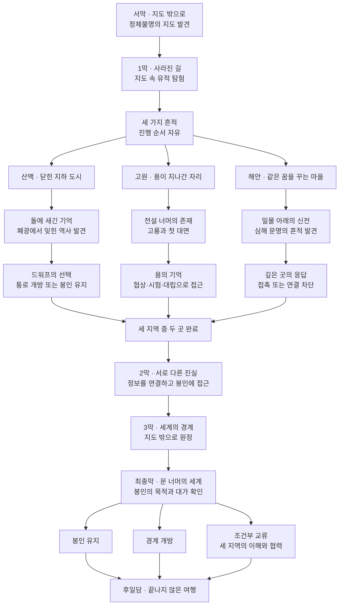

# 초기 게임 기획서

프로젝트: BaseProject_SE  
버전: 0.2  
작성일: 2026-09-09  
게임명: 미정

## 1. 기획 목적과 결정 상태

이 문서는 지금까지의 요구사항을 종합해 향후 상세 기획과 초기 제작의 기준을 정리한다. [게임 개발 기준](GAME_DESIGN.md)과 [Codex 작업 지침](../AGENTS.md)을 기반으로 작성했다.

- **확정 방향:** 실시간 렌더링, 쿼터뷰, 2.5D, 오픈 월드 RPG, 중세 판타지, 자유로운 탐험, 미지의 존재와 종족을 알아가는 이야기, 싱글플레이, C++/OpenGL 유지, 회복·부활의 대가, 선택 이력의 세계 반영.
- **유지할 기본 골격:** 오래된 지도로 시작하는 여행, 세 지역의 독립적인 이야기, 세계의 경계와 봉인에 관한 후반부, 선택에 따른 결말과 이후 탐험.
- **상세 초안:** 퀘스트 이름, 개별 사건과 인물. 기본 골격 안에서 구체화한다.
- **신규 제안:** 이 문서의 핵심 플레이 흐름과 초기 제작 범위. 별도 합의 전에는 확정 구현 항목으로 취급하지 않는다.

문서는 구현 완료 보고서가 아니다. 기본 방향을 바꿀 때는 사용자와 합의하고 관련 문서에 함께 반영한다.

## 2. 게임 개요

> 낯선 세계를 자유롭게 여행하며, 미지의 존재를 이해해 가는 실시간 렌더링 기반의 쿼터뷰 2.5D 싱글플레이 오픈 월드 RPG.

| 항목 | 방향 |
|---|---|
| 장르 | 오픈 월드 RPG |
| 플레이 방식 | 싱글플레이 |
| 회복과 부활 | 회복과 부활에는 각각 대가가 있음 |
| 선택과 세계 | 플레이어의 선택 이력이 세계 상태에 반영됨 |
| 시대 | 검과 마법이 공존하는 중세 판타지 |
| 시점과 표현 | 쿼터뷰, 2.5D, 실시간 렌더링 |
| 중심 경험 | 여행, 발견, 만남, 이해, 선택 |
| 기본 정서 | 자유로움, 설렘, 경이로움 |
| 주요 대상 | 드워프, 용, 크툴루 같은 미지의 존재와 종족 |
| 플레이어의 위치 | 방문할 장소와 관계를 맺을 대상을 선택하는 탐험가 |
| 기술 기준 | C++ / OpenGL 유지. 기존 Visual Studio 프로젝트에서 개발 |
| 미정 | 출시 플랫폼, 대상 이용자, 전투 방식, 전체 규모와 일정 |

실시간 렌더링은 화면 표현에 관한 기준이다. 실시간 전투까지 확정된 것은 아니다. 현재 개발 환경과 최종 출시 플랫폼도 구분한다.

## 3. 핵심 경험과 분위기

### 스스로 정하는 여행

플레이어는 소문과 흔적을 따라 다음 목적지를 선택한다. 메인 퀘스트 도중에도 다른 곳을 탐험할 수 있으며, 세 주요 지역의 방문 순서를 고정하지 않는다. 초·중반에는 세계 멸망 카운트다운으로 이동을 재촉하지 않는다.

자유로운 탐험이 목적 없는 이동이 되지 않도록 각 지역에 궁금증과 발견의 이유를 둔다. 길 안내와 지도 UI의 구체적인 방식은 추후 정한다.

### 만남을 통해 바뀌는 이해

종족과 존재는 각자의 생활, 역사, 목적을 가진다. 소문에서 출발해 흔적을 추적하고 직접 대면하면서 처음의 인식과 실제 모습의 차이를 알아간다. 모든 종족과 친해지는 것을 진행의 필수 조건으로 만들지 않는다.

### 회복·부활의 대가와 선택 이력

회복과 부활에는 각각 대가가 있다. 대가의 종류, 크기, 지불 시점과 적용 조건은 상세 기획에서 정한다. 특정 재화 소모나 영구 손실 등의 방식을 현재 확정하지 않는다.

플레이어의 선택 이력은 이후 세계 상태에 반영한다. 최종 결말뿐 아니라 진행 중의 선택도 세계 반응의 근거가 된다. 반영할 선택의 범위, 누적·상충하는 선택의 처리, 변화 시점과 지속 범위는 추후 정한다. 회복·부활 시 선택 이력과 세계 상태를 어떻게 처리할지도 상세 규칙으로 결정한다.

### 공간에 따라 달라지는 감정

| 공간 | 중심 감정 | 경험의 방향 |
|---|---|---|
| 마을과 교역로 | 따뜻함과 기대 | 쉬어 가며 다음 여행의 단서를 접함 |
| 야외와 미개척지 | 자유로움과 호기심 | 낯선 지형과 흔적을 따라 이동 |
| 유적과 지하 공간 | 신비함 | 기록과 구조에서 잊힌 역사를 발견 |
| 심해와 세계의 경계 | 경이로움과 두려움 | 익숙한 지식으로 설명하기 어려운 존재와 대면 |

공포는 특정 지역과 서사에서 강해진다. 게임 전체의 기본 정서는 다음 장소를 보고 싶은 모험의 즐거움으로 유지한다. 모든 수수께끼를 설명하지 않아 엔딩 이후에도 미지의 영역이 남는다.

## 4. 세계관과 주요 존재

도시와 교역로 밖에는 아직 지도에 기록되지 않은 땅이 많다. 오래된 지도에만 남아 있던 장소들이 다시 발견되면서 서로 떨어져 있던 종족들의 역사와 세계의 비밀이 연결된다.

| 대상 | 알아가는 방식 | 메인 스토리에서의 역할 |
|---|---|---|
| 드워프 | 지하 도시의 생활·기술·전통을 접하고 폐광과 기록을 탐험 | 세계를 연결하는 고대 통로를 건설한 선조의 후손 |
| 용 | 흔적과 전설을 추적한 뒤 협상·시험·대립을 통해 접근 | 봉인 이전의 세계를 기억하는 존재 |
| 심해의 존재 | 같은 꿈, 물 아래의 신전, 기이한 자연 현상으로 간접 접촉 | 봉인 너머에서 접촉을 시도하며 이해의 한계를 드러내는 존재 |

크툴루는 이해하기 어려운 고대 존재의 방향을 나타내는 예시다. 원전의 크툴루 자체를 등장시킬지, 고유 명칭과 정확한 정체는 미정이다.

## 5. 스토리 개요

플레이어는 첫 여행에서 현실의 지형과 맞지 않는 지도를 얻는다. 지도에만 존재하는 유적을 탐험하자 산맥, 고원, 해안으로 이어지는 세 가지 흔적이 나타난다.

각 지역에서 드워프의 고대 통로, 용이 기억하는 역사, 심해에서 오는 응답을 접한다. 서로 다른 증언은 같은 봉인과 연결되며, 봉인이 누구를 위해 만들어졌고 무엇을 막고 있는지에 대한 질문으로 이어진다.

후반에는 지도에 없던 땅으로 원정을 떠나 세계의 경계에 도달한다. 봉인의 목적과 유지·개방의 대가를 확인하고 그동안 얻은 정보와 맺은 관계를 바탕으로 선택한다.

초반 프로토타입에서 플레이어는 길과 이야기를 기록하는 여행자이며, 잘못된 지도를 고치다가 고대 통로를 추적한다. 호수의 선택 후에는 도적이 점거한 옛 드워프 교역로를 거쳐 솔바람 분지의 다음 이정표로 향한다. 세부 사건과 구현 범위는 [게임 개발 기준](GAME_DESIGN.md)의 초반 이야기 절을 따른다. 출신과 개인사의 전체 설정, 지도와 봉인의 최종 기원은 아직 정하지 않는다.

## 6. 메인 퀘스트 트리

아래 명칭은 작업용 초안이다. 합류 지점은 세 지역 모두가 아니라 **세 지역 중 두 곳 완료**를 요구한다.

| 지역 | 처음의 목적 | 후반부에 제공하는 것 |
|---|---|---|
| 산맥 | 사라진 길 찾기 | 원정 경로와 통로 제어 기술 |
| 고원 | 살아 있는 용 만나기 | 봉인의 역사와 개방 위험에 대한 지식 |
| 해안 | 이상한 꿈의 근원 찾기 | 미지의 존재의 의도를 해석하고 소통할 가능성 |

### 진행 규칙

- 세 지역은 원하는 순서로 진행하고, 첫 퀘스트는 여행 중 자연스럽게 발견하도록 설계한다.
- 두 곳을 완료하면 2막이 열린다. 한 곳만 완료해서는 열리지 않는다.
- 두 지역만으로 결말까지 진행할 수 있다. 미방문 지역의 정보나 기술 때문에 필수 진행이 막히지 않도록 상세 기획에서 대체 경로를 검토한다.
- 남은 지역은 판단 근거와 선택지를 늘린다. 세 번째 지역을 방문할 수 있는 시점과 최종 선택 전 복귀 가능 여부는 미정이다.
- 조건부 교류는 세 지역의 이해와 협력을 바탕으로 한다. 세 지역 완료만으로 자동 해금되는지 등 정확한 조건은 미정이다.
- 지역에서의 대립·봉인·접촉 차단과 후반 선택의 연결 조건을 상세 기획에서 정의한다.

## 7. 결말과 이후 탐험

| 결말 | 의미 | 남는 대가 |
|---|---|---|
| 봉인 유지 | 현재 세계를 지키고 경계 너머와의 교류 제한 | 단절과 교류 기회의 상실 |
| 경계 개방 | 새로운 존재와 세계를 받아들임 | 새로운 위험과 불확실성 |
| 조건부 교류 | 이해와 협력을 바탕으로 연결 | 경계를 관리하고 관계를 이어 갈 책임 |

각 선택은 서로 다른 대가를 가진다. 엔딩 이후에도 탐험을 계속할 수 있고, 선택은 교역로·방문 가능한 장소·종족 간 관계에 반영한다. 구체적인 변화 범위와 후일담 콘텐츠 양은 미정이다.

## 8. 핵심 플레이 흐름 — 제안

탐험 중심 방향을 플레이 단위로 구체화한 제안이다.

**단서 발견 → 목적지 선택 → 이동과 탐험 → 존재·기록과 만남 → 이해와 선택 → 새로운 탐험 기회 발견**

| 단계 | 플레이어의 행동 | 제공하려는 경험 |
|---|---|---|
| 단서 발견 | 소문·지도·환경의 흔적을 접함 | 궁금증과 여행의 이유 |
| 목적지 선택 | 다음에 갈 곳을 고름 | 여행의 주도권 |
| 탐험 | 낯선 지형과 공간에 접근 | 발견의 즐거움 |
| 만남과 조사 | 존재와 교류하거나 기록을 살펴봄 | 세계에 대한 이해 |
| 선택 | 얻은 정보로 태도와 행동 결정 | 자기 판단의 의미 |
| 다음 여행 | 달라진 길이나 새로운 단서 발견 | 탐험을 이어 갈 동기 |

이 흐름은 전투·성장·아이템의 상세 규칙을 확정하지 않는다. 보상 구성과 전투 비중은 이후 RPG 시스템 기획에서 정한다.

## 9. 화면 표현과 기술 기준

쿼터뷰에서 지형과 캐릭터의 위치 관계를 읽을 수 있는 2.5D 화면을 목표로 한다. 구체화할 때는 다음을 확인한다.

- 높이 차이와 앞뒤 관계를 구분할 수 있는가?
- 건물이나 지형에 가려져 캐릭터와 이동 경로를 놓치지 않는가?
- 화면에서 보이는 형태와 실제 이동·상호작용 범위가 일치하는가?
- 지역별 분위기를 표현하면서 탐험에 필요한 시인성을 유지하는가?

스프라이트와 3D 모델의 구성, 투영 방식, 카메라 각도·회전·줌, 아트 스타일은 미정이다. 쿼터뷰라는 이유만으로 정확한 등각 투영이나 고정 카메라를 확정하지 않는다.

C++ / OpenGL을 유지하며 기존 Visual Studio 프로젝트에서 필요한 기능부터 구현한다. 엔진이나 기술 스택을 임의로 교체하지 않는다. 월드 크기, 지역 간 로딩, 스트리밍과 성능 목표는 별도 결정한다. 오픈 월드가 무조건 무로딩 구조를 의미하지는 않는다.

## 10. 초기 제작 범위 — 제안

전체 세계 제작 전에 작은 탐험 구간에서 핵심 경험과 화면 표현을 확인하는 범위를 제안한다. 확정 구현 지시나 일정은 아니다.

| 단계 | 제안 범위 | 사용자가 확인할 기준 |
|---|---|---|
| 화면과 이동 | 작은 테스트 공간, 임시 캐릭터, 쿼터뷰 카메라 | 공간의 앞뒤·높이와 이동을 이해할 수 있음 |
| 짧은 탐험 | 출발 거점과 인접 야외, 단서와 목적지 | 단서를 보고 탐험할 이유가 생김 |
| 이야기 한 구간 | 지도 발견부터 작은 유적 조사까지 | 발견과 조사로 다음 여행이 궁금해짐 |
| 선택과 반응 | 한 가지 상황의 선택과 확인 가능한 변화 | 선택이 무엇을 바꿨는지 이해할 수 있음 |

초기 단계에서 대규모 맵, 세 종족의 전체 시나리오, 완성형 전투·성장을 동시에 제작할 필요는 없다. 확인 결과를 바탕으로 다음 제작 범위를 정한다.

## 11. 추가 결정 항목

| 영역 | 필요한 결정 | 영향 |
|---|---|---|
| 플레이 환경 | 목표 플랫폼, 입력 장치 | 조작·UI·기술 구조 |
| 화면 표현 | 2D·3D 구성, 카메라, 아트 스타일 | 에셋 제작과 렌더링 |
| 전투와 성장 | 전투 방식·비중, 능력치, 직업, 성장·보상 | RPG의 반복 플레이 |
| 회복과 부활 | 대가의 종류·크기·지불 시점·적용 조건 | 회복과 재도전의 판단 |
| 선택 이력 | 반영 대상, 누적·상충 처리, 변화 시점·지속 범위, 회복·부활 시 처리 | 세계 상태와 선택의 일관성 |
| 탐험 | 이동, 지도 표시, 상호작용, 탐험 보상 | 발견과 목적지 선택 |
| 세계 규모 | 지역 크기·밀도, 연결과 로딩 방식 | 제작량과 월드 구조 |
| 서사 | 주인공의 출신·동기, 고유 명칭, 지도·봉인의 기원 | 인과관계와 개인적 동기 |
| 퀘스트 | 완료 기준, 대립 시 대체 경로, 결말 조건 | 자유로운 순서와 진행 가능성 |
| 제품 범위 | 대상 이용자, 플레이 시간, 인력과 일정 | 실현 가능한 제작 목표 |

초기 제작 전에는 화면 표현·이동 조작 등 구조에 영향을 주는 결정을 먼저 다루는 것을 제안한다. 미정인 수치와 설정을 임의로 확정하지 않는다.

## 12. 개발 운영

- 합의된 기본 틀을 유지하고 요청 범위에 필요한 최소 변경을 수행한다.
- 특별한 상황이 아니면 빌드와 실행 결과 확인은 사용자가 직접 한다.
- Codex는 변경 내용과 필요한 확인 항목을 전달한다. 직접 빌드·실행이 필요한 예외에는 먼저 이유를 설명한다.
- 기본 방향 변경 시 이 문서와 GAME_DESIGN.md를 함께 갱신한다. 작업 방식 변경은 AGENTS.md에도 반영한다.
- 설계 구상과 구현 상태를 구분한다. 커밋과 GitHub 푸시는 해당 요청 범위에 따른다.

## 13. 요구사항 반영 확인

| 요구사항 | 반영 위치 |
|---|---|
| 실시간 렌더링·쿼터뷰·2.5D | 2장, 9장 |
| 싱글플레이 오픈 월드 RPG | 2장, 3장, 9장 |
| C++ / OpenGL 유지 | 2장, 9장 |
| 회복·부활의 대가와 선택 이력의 세계 반영 | 2장, 3장, 11장 |
| 중세 판타지·자유로운 탐험 | 2장, 3장, 4장 |
| 미지의 존재와 종족을 알아가는 스토리 | 3장, 4장, 5장 |
| 메인 퀘스트 트리 | 6장, 7장 |
| 향후 유지할 기본 틀 | 1장, 12장 |
| 사용자 직접 빌드·결과 확인 | 10장, 12장 |
