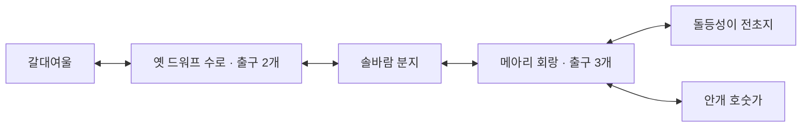

# 던전 출입구와 지역 이동

지역 이동 기준일: 2026-10-27 (LEC06).

지역 이동은 화면에 배치된 출입구 Actor 가까이에서 E로 수행한다. L로 어디서나 사냥터에 들어가는 기능을 제거했다. 성장 목표를 달성하기 전에도 출구는 이용할 수 있고, 호수의 어느 선택도 여행을 막지 않는다.

## 연결된 지역

| 지역 | 배치된 출입구와 목적지 |
|---|---|
| 갈대여울 | (49,59) → 옛 드워프 수로 |
| 옛 드워프 수로 | (7,7) → 갈대여울 / (185,153) → 솔바람 분지 |
| 솔바람 분지 | (7,7) → 옛 드워프 수로 / (185,153) → 메아리 회랑 |
| 메아리 회랑 | (7,7) → 솔바람 분지 / (185,81) → 돌등성이 전초지 / (97,153) → 안개 호숫가 |
| 돌등성이 전초지 | (7,7) → 메아리 회랑 |
| 안개 호숫가 | (7,7) → 메아리 회랑 |

WorldTravel.h의 지역별 연결 목록이 출구 개수·위치·목적지의 기준이다. 출구마다 Actor를 만들고 실제 월드 위치로 거리·시야 검사를 수행한다. M 지도와 가까운 출입구 안내에 목적지를 표시한다. 새로운 던전을 추가할 때 모든 던전에 같은 출구 두 개를 복제하지 않고 이야기와 지형에 맞는 연결을 지정한다.

이동할 지역에서 방금 떠난 지역을 가리키는 출입구를 찾아 그 위치에 도착한다. 예를 들어 안개 호숫가에서 회랑으로 돌아오면 남쪽 호숫가 출구에 도착하며, 분지 출구로 옮겨지지 않는다. 갈대여울 귀환은 입구 앞의 비워 둔 접근로에 도착한다.

수로와 회랑은 돌바닥·바위가 이어지는 도적의 고대 교역 통로다. 분지에는 숲과 물웅덩이, 돌등성이에는 마른 바위 지형, 안개 호숫가에는 물웅덩이와 청록 지면을 사용한다. 바깥 세 지역에는 산맥·고원·해안의 흔적이 새겨진 이정표가 있다. 이는 별도 탐험 지역이며 본편의 드워프·용·심해 퀘스트를 이미 완료 구현했다는 뜻은 아니다.

## 길을 잃는 외곽

- 마을의 비어 있던 곳을 숲으로 보충하고, 도로·집·호수·NPC 출발점·동물·퀘스트 단서·입구 주변은 비워 둔다.
- 일반 지역의 바깥에는 숲과 지면, 던전 바깥에는 바위와 돌바닥을 48단위 더 배치하여 지도의 끝에서 바닥이 끊겨 보이지 않게 한다. 경계 장식도 Actor 소유이며 구역 단위로 그리기에서 제외한다.
- 맵 가장자리 4단위 이내로 들어오면 마지막으로 지나간 안쪽 통행 위치로 돌아온다. 기준 위치는 가장자리에서 12단위 이상 떨어진 실제 플레이어 위치로 갱신한다. 입장 직후에는 도착한 출입구가 기준이다.
- 일반 지역: “숲에서 길을 잃고 한참 헤매다 익숙한 길로 돌아왔습니다.”
- 던전: “어두운 통로에서 방향을 잃고 헤매다 익숙한 갈림길로 돌아왔습니다.”
- 카메라를 도착 위치에 맞추고, 잡고 있던 이동 입력을 비운다. 이 처리는 지역 이동이나 사망이 아니며 경험치·가방·퀘스트·선택을 초기화하거나 체력을 회복하지 않는다. 전투 지역에서는 기존 피격 유예 0.6초를 적용해 귀환 즉시 타격받는 현상을 줄인다.
- 지도·가방·대화·일시정지 중에는 기존대로 이동을 멈춘다. 실제 지역 이동은 출입구에서만 일어난다. 무한 청크 스트리밍 구현은 아니다.

## 진행과 생성

갈대여울의 기존 튜토리얼 단계·호수 선택·주민 상태는 왕복해도 유지한다. 전투 지역 사이에는 레벨·누적 경험치·현재 체력·동전·탐험 결정을 이어간다. 이동할 때마다 기존 첫 레벨과 같이 새 시드로 지형과 적을 생성하며, 미획득 바닥 전리품은 남기지 않는다. 각 활성 전투 지역에는 기존처럼 64구역에 세 마리씩 192마리를 배치한다. 전 지역 몹을 동시에 갱신하거나 합산하는 구조는 아니다.

출입구 주변은 장애물 생성과 몹 초기 배치에서 제외한다. 두 던전과 세 야외 지역 모두 이동 가능한 전체 지면이 연결되도록 생성한다. 출구 주변은 기존 야영지처럼 추격·공격 안전 범위로 처리한다. 이정표 주변도 안전하게 비워 둔다. 문 자체는 보행을 막지 않으며 상호작용 지점과 시각 표식이다.

모니터 JSON의 scene에는 tutorial, first_level, basin, echo_hall, stone_ridge, mist_shore를 사용한다. first_level은 기존 호환을 위해 옛 수로의 키로 유지한다. 몹 수는 현재 불러온 전투 지역 또는 마을에 돌아오기 직전 마지막 전투 지역의 값이다.

## 검증

tests/RunTravelChecks.cmd로 게임 창 없이 독립 테스트를 컴파일·실행한다. 결과와 Visual Studio의 실제 게임 빌드·플레이 확인을 구분한다.

MSVC x64 /O2 /MD 독립 컴파일·링크 및 아래 네 테스트의 실행을 통과했다. 테스트용 실행 파일은 호출 환경의 TEMP 폴더에 생성하며 게임 창은 열지 않는다. 실제 게임 빌드·화면·플레이 확인은 수행하지 않았다.

- WorldTravelTests: 실제 입력 처리로 L 단축 진입 제거, E 진입, 두 던전의 모든 분기 왕복, 도착 출입구, 지도/일시정지, 모니터 지역, 퀘스트·선택·입력 보존을 검사한다. 실제 나무를 생성한 마을에서 주요 튜토리얼 지점과 입구까지 통행 가능 여부도 탐색한다.
- RegionConnectivityTests: 5개 지역 × 32개 시드의 전체 연결성, 출구 수·목적지·역방향 연결, 안전한 출구, 192마리와 64구역 분배, 양 던전과 숲의 네 방향 귀환 및 성장·체력·가방 보존을 검사한다.
- 기존 LevelExpansionTests와 TutorialPopulationTests로 전투·전리품·재등장, 38명 주민과 35개 이동 루틴을 확인한다.

사용자는 Release | x64에서 마을 동쪽 돌문으로 걸어가 E로 들어간 뒤 M으로 목적지를 확인하고, 회랑의 세 출구를 각각 왕복한다. 숲과 던전의 외곽에서 귀환 문구·도착 위치·멈춤을 확인하고, 문에 접근할 때의 시각 가독성·프레임도 확인한다. 실제 OpenGL 화면·입력 감각·GPU 비용·FPS는 독립 테스트로 검증되지 않는다.
